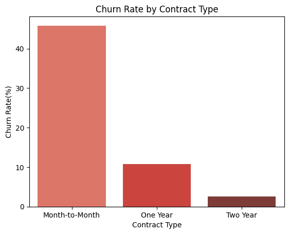
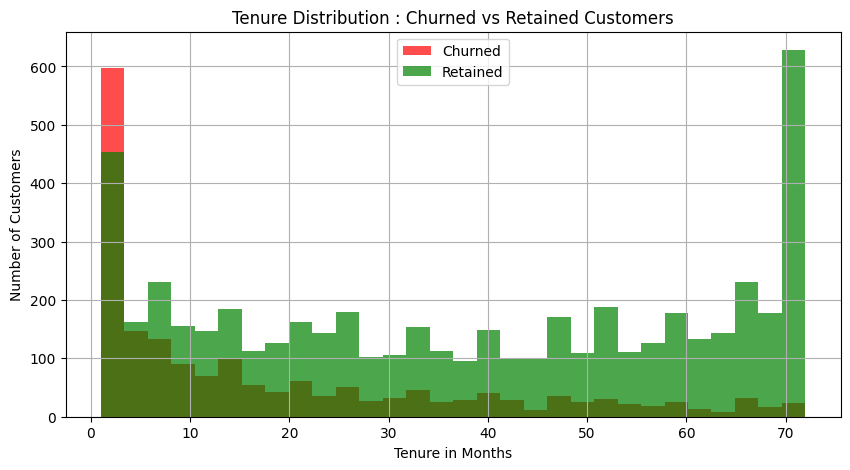
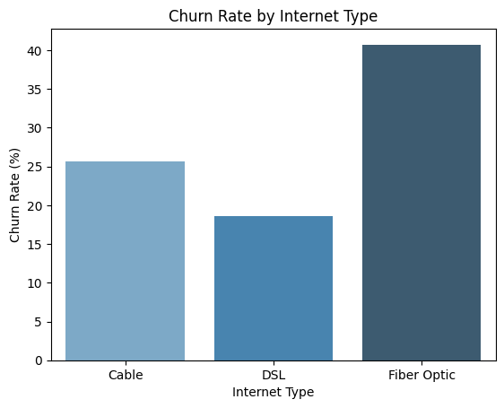
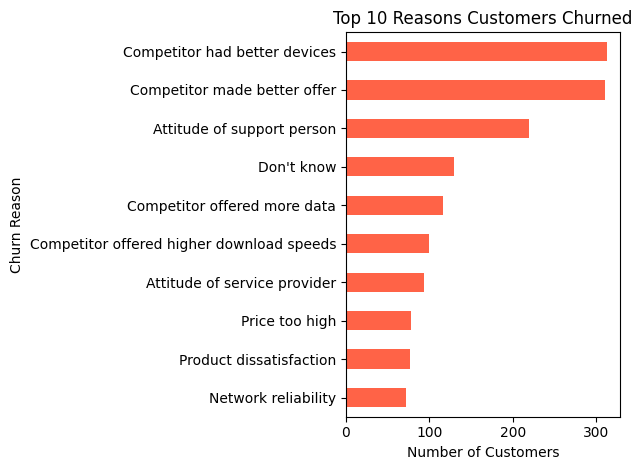
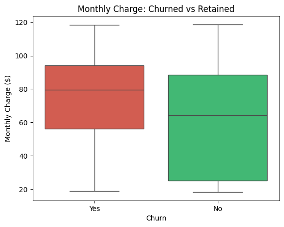
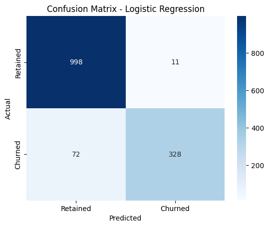
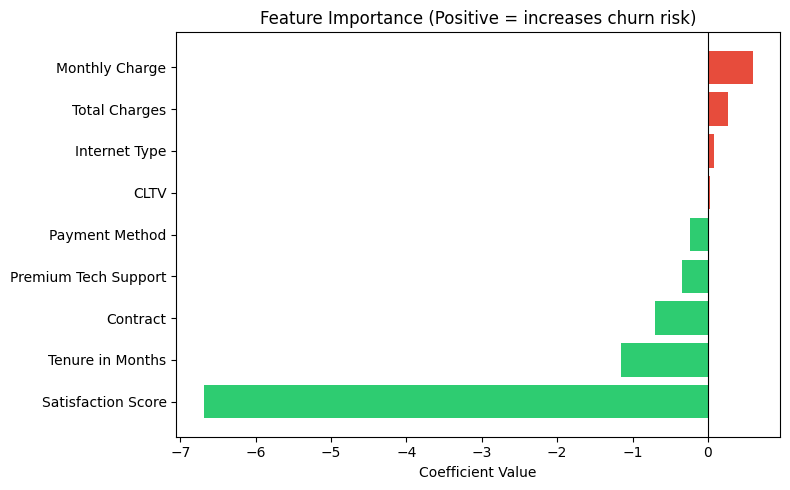

# 📉 Customer Churn Analysis - Telecom Industry


> Identifying which telecom customers are most likely to churn - and why - using SQL exploration, Python EDA, and logistic regression.

---

## 🔍 Business Problem

Customer churn is one of the most expensive problems in the telecom industry. Acquiring a new customer costs 5-7x more than retaining an existing one. This project answers three questions a business actually cares about:

1. Which customer segments are most at risk of churning?
2. What factors drive churn the most?
3. Can we predict which specific customers will churn before they do?

---

## 📊 Key Findings

- **Month-to-month contract customers churn at 45.8%** - nearly 18x higher than two-year contract customers (2.5%)
- **Customers in their first 12 months are the highest-risk group**, with a 47.4% churn rate - almost double the overall average of 26.5%
- **Fiber optic internet users churn at 40.7%** compared to 18.6% for DSL users, despite paying higher monthly charges - a clear signal of a pricing or service quality issue
- **Top churn reason:** Competitor had better devices (313 customers) followed by competitor made a better offer (311 customers) - meaning most churn is competitive, not service failure
- **Revenue at risk:** $112,491 per month from 1,267 high-value churners (monthly charge > $70)

---

## 🖼️ Visualizations

### Churn Rate by Contract Type


### Tenure vs Churn Distribution


### Churn Rate by Internet Type


### Top 10 Reasons Customers Churned


### Monthly Charge - Churned vs Retained


### Confusion Matrix


### Feature Importance


---

## 🤖 Model Performance

| Metric | Score |
|--------|-------|
| Algorithm | Logistic Regression |
| Accuracy | 94.1% |
| ROC-AUC | 0.98 |
| Top Predictors | Satisfaction Score, Tenure in Months, Contract Type |

---

## 🛠️ Tech Stack

| Tool | Purpose |
|------|---------|
| MySQL | Schema design, data loading, 10 business queries |
| Python (pandas) | Data cleaning and EDA |
| Python (matplotlib, seaborn) | 9 visualizations |
| Python (scikit-learn) | Logistic regression + confusion matrix |
| Jupyter Notebook | Analysis environment |

---

## 📁 Project Structure

```
customer-churn-analysis/
│
├── data/
│   └── telco.csv                    # IBM Telco Customer Churn dataset (50 columns, 7,043 rows)
│
├── sql/
│   ├── schema.sql                   # Database + table creation (all 50 columns)
│   └── exploration.sql              # 10 business queries across 4 sections
│
├── notebooks/
│   ├── 01_eda.ipynb                 # 8 EDA analyses with charts
│   └── 02_prediction.ipynb          # Logistic regression model
│
├── visuals/
│   ├── churn_distribution.png
│   ├── churn_by_contract.png
│   ├── tenure_vs_churn.png
│   ├── monthly_charge_vs_churn.png
│   ├── churn_by_internet_type.png
│   ├── churn_by_tech_support.png
│   ├── churn_by_payment.png
│   ├── top_churn_reasons.png
│   ├── satisfaction_vs_churn.png
│   ├── confusion_matrix.png
│   └── feature_importance.png
│
├── load_data.py                     # Loads CSV into MySQL with column renaming
└── README.md
```

---

## ⚙️ Setup & Run

### 1. Clone the repo
```bash
git clone https://github.com/pushkesh-m/customer-churn-analysis.git
cd customer-churn-analysis
```

### 2. Install dependencies
```bash
pip install pandas matplotlib seaborn scikit-learn sqlalchemy pymysql jupyter
```

### 3. Set up MySQL database
Run `sql/schema.sql` in MySQL Workbench to create the `churn_analysis` database and `customers` table.

### 4. Load the data
```bash
python load_data.py
```
Update the MySQL connection string in `load_data.py` with your username and password before running.

### 5. Run SQL exploration
Open `sql/exploration.sql` in MySQL Workbench and run the 10 queries.

### 6. Run the notebooks
```bash
jupyter notebook
```
Open `notebooks/01_eda.ipynb` first, then `notebooks/02_prediction.ipynb`.

---

## 📂 Dataset

**Source:** IBM Telco Customer Churn (Extended Version)
- **Rows:** 7,043 customers
- **Columns:** 50 features including Churn Reason, Churn Category, CLTV, and Satisfaction Score
- **Target:** `Churn Label` (Yes / No)
- Available on [Kaggle](https://www.kaggle.com/datasets/shilongzhuang/telecom-customer-churn-by-maven-analytics)

---

## 💡 Business Recommendations

Based on the analysis:

1. **Offer month-to-month customers a discount to switch to annual contracts in their first 12 months** - this is the single highest-impact action given the 45.8% vs 2.5% churn gap between contract types
2. **Create an early retention program for fiber optic customers paying above $70/month** - this segment has a 40.7% churn rate and accounts for $112,491 in monthly revenue at risk
3. **Respond directly to competitor positioning** - 624 of 1,869 churned customers left because a competitor offered better devices or a better deal; loyalty pricing or a device upgrade program would directly address the top churn driver

---

## 📬 Connect

**GitHub:** [pushkesh-m](https://github.com/pushkesh-m)

---

*This project was built as part of a data analytics portfolio. Dataset is publicly available on Kaggle.*
